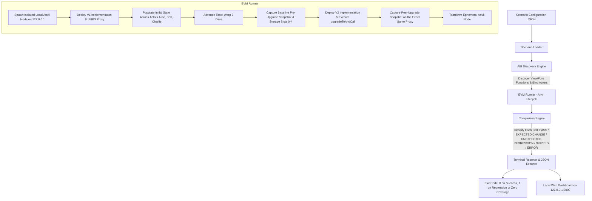

# UpgradeLens 🔍
> **Stateful smart-contract upgrade regression testing engine.**

UpgradeLens detects behavioral regressions across EVM proxy upgrades where standard storage-layout validation passes with zero collisions, but contract logic incorrectly interprets uninitialized legacy storage.

---

## 🎯 Purpose & Problem Statement

When maintaining upgradeable smart contracts (e.g., UUPS or ERC-1967 transparent proxies), contract state remains stored inside the proxy, while implementation logic is replaced.

Standard static verification tools (such as `forge inspect storageLayout` and OpenZeppelin Upgrades Core storage linters) verify that existing storage slot offsets and variable types are not overwritten. **However, static storage linters cannot verify semantic runtime correctness.**

### The Representative Failure Pattern
If an upgrade appends a new state variable (e.g., `mapping(address => uint256) public stakedSince` in Slot 4), all existing users have uninitialized zero bytes (`0x00`) in that newly allocated storage slot. If new V2 contract functions assume this variable is populated:
- Legacy users can be locked out.
- Accrued rewards can drop to zero.
- Balances or voting eligibility can silently regress.
- Storage-layout linters report `SUCCESS (0 Collisions)` because the layout is strictly append-only.

> **Representative Pattern Note**: The uninitialized mapping demonstrated in this repository represents a common, realistic pattern in proxy upgrades (assuming new fields are backfilled for existing accounts). It is presented as an illustrative security scenario, not a measured statistical frequency claim.

**UpgradeLens bridges this gap by taking stateful snapshots across real actors on the exact same proxy before and after an upgrade in an isolated local EVM.**

---

## 📐 Architecture & Execution Lifecycle



---

## 💻 Prerequisites & Environment

Observed and verified on macOS (Apple Silicon / Darwin):
- **Foundry / Forge**: `1.8.5` (commit `51a52c59cffd940f76eddd0b4bb1791aa4b5ac7f`, build `2026-10-05T17:07:33Z`)
- **Anvil**: `1.8.5` (commit `51a52c59cffd940f76eddd0b4bb1791aa4b5ac7f`, build `2026-10-05T17:07:33Z`)
- **Node.js**: `v22.17.0` (ESM module support)
- **Solidity (`solc`)**: `0.8.28` (configured in `foundry.toml`)
- **OpenZeppelin Contracts**: `v5.2.0` (and `@openzeppelin/contracts-upgradeable v5.2.0`)
- **OpenZeppelin Upgrades Core CLI**: `@openzeppelin/upgrades-core 1.46.0` (resolved via `npx -y @openzeppelin/upgrades-core`)

> **Offline vs Network Note**: The UpgradeLens CLI, test runner, Anvil nodes, and web dashboard run completely offline with no network dependencies. Only `npm run oz:check` requires network access for `npx` to fetch or verify `@openzeppelin/upgrades-core` from the npm registry if not already cached.

---

## 🛠 Installation & Setup

```bash
# 1. Clone repository
git clone https://github.com/upgradelens/upgradelens.git
cd UPGRADELENS

# 2. Install Node dependencies (development only: chalk, viem)
npm install

# 3. Build smart contracts with build-info and storageLayout outputs
forge build --build-info --extra-output storageLayout
```

---

## 🚀 Exact Verification Commands

### 1. Full Self-Test Suite (`npm test`)
Executes the unified 10-step self-test battery in sequence and prints a verified pass/fail table:
```bash
npm test
```
*Observed Output: All 10 steps passed, exit code 0.*

### 2. OpenZeppelin Upgrades-Core Validation (`npm run oz:check`)
Executes OpenZeppelin validation for all V2 contracts (`StakingVaultV2_Buggy`, `StakingVaultV2_Clean`, `StakingVaultV2_PartialBug`), once with `--unsafeAllow missing-initializer` and once without:
```bash
npm run oz:check
```

### 3. Run Buggy Upgrade Regression (Expects Exit 1)
```bash
node ./bin/upgradelens.js --config scenarios/buggy_upgrade.json
echo "Exit code: $?"
```

### 4. Run Partial-Bug Upgrade Scenario (Expects Exit 1, flags Charlie only)
```bash
node ./bin/upgradelens.js --config scenarios/partial_bug_upgrade.json
echo "Exit code: $?"
```

### 5. Run Clean Upgrade Control (Expects Exit 0; passed 5 of 5 consecutive runs)
```bash
node ./bin/upgradelens.js --config scenarios/clean_upgrade.json
echo "Exit code: $?"
```

### 6. Launch Local Web Dashboard (Localhost 127.0.0.1 Only)
```bash
node server.js
```
Open [http://127.0.0.1:3000](http://127.0.0.1:3000) in your browser.

---

## 📊 Real Output: Buggy vs Clean Upgrade Runs

### Buggy Upgrade Run (Uninitialized Legacy State Wipe)
Command: `node ./bin/upgradelens.js --config scenarios/buggy_upgrade.json` (Exits 1):
```text
================================================================================
                          UPGRADELENS REGRESSION REPORT                         
================================================================================
Scenario:      Staking Vault: V1 to V2_Buggy Upgrade (Uninitialized State Regression)
Proxy Address: 0xe7f1725e7734ce288f8367e1bb143e90bb3f0512
V1 Logic:      0x5fbdb2315678afecb367f032d93f642f64180aa3
V2 Logic:      0x9fe46736679d2d9a65f0992f2272de9f3c7fa6e0
Actors Tested: alice (100 ETH), bob (250 ETH), charlie (50 ETH)

OBSERVATION COMPARISON MATRIX:
FUNCTION                ACTOR     V1 (BEFORE)               V2 (AFTER)                STATUS
---------------------------------------------------------------------------------------------------------
UPGRADE_INTERFACE_V...  GLOBAL    5.0.0                     5.0.0                      PASS 
getClaimableReward      alice     60480000000000000000      0                          UNEXPECTED REGRESSION 
   ↳ Value shifted from '60480000000000000000' to '0' without scenario authorization
getClaimableReward      bob       151200000000000000000     0                          UNEXPECTED REGRESSION 
   ↳ Value shifted from '151200000000000000000' to '0' without scenario authorization
getClaimableReward      charlie   30240000000000000000      0                          UNEXPECTED REGRESSION 
   ↳ Value shifted from '30240000000000000000' to '0' without scenario authorization
isEligibleForReward     alice     true                      false                      UNEXPECTED REGRESSION 
   ↳ Value shifted from 'true' to 'false' without scenario authorization
isEligibleForReward     bob       true                      false                      UNEXPECTED REGRESSION 
   ↳ Value shifted from 'true' to 'false' without scenario authorization
isEligibleForReward     charlie   true                      false                      UNEXPECTED REGRESSION 
   ↳ Value shifted from 'true' to 'false' without scenario authorization
lastClaimTimestamp      alice     1792389288                1792389288                 PASS 
lastClaimTimestamp      bob       1792389288                1792389288                 PASS 
lastClaimTimestamp      charlie   1792389288                1792389288                 PASS 
owner                   GLOBAL    0xf39Fd6e51aad88F6F4c...  0xf39Fd6e51aad88F6F4c...   PASS 
rewardRatePerSecond     GLOBAL    1000000000000             1000000000000              PASS 
stakes                  alice     100000000000000000000     100000000000000000000      PASS 
stakes                  bob       250000000000000000000     250000000000000000000      PASS 
stakes                  charlie   50000000000000000000      50000000000000000000       PASS 
totalStaked             GLOBAL    400000000000000000000     400000000000000000000      PASS 
version                 GLOBAL    V1                        V2_Buggy                   EXPECTED CHANGE 
   ↳ Approved change: Implementation version updated to V2_Buggy

SUMMARY: 10 PASS | 1 EXPECTED CHANGE | 6 REGRESSION | 0 ERROR | 1 SKIPPED (READ-ONLY) | 5 NOT APPLICABLE (NON-VIEW)
VERDICT: UNEXPECTED REGRESSION DETECTED (Exit 1)
```

### Clean Upgrade Run (Continuous Preservation & Approved Bonus)
Command: `node ./bin/upgradelens.js --config scenarios/clean_upgrade.json` (Exits 0):
```text
================================================================================
                          UPGRADELENS REGRESSION REPORT                         
================================================================================
Scenario:      Staking Vault: V1 to V2_Clean Upgrade (Controlled & Approved State Preservation)
Proxy Address: 0xe7f1725e7734ce288f8367e1bb143e90bb3f0512
V1 Logic:      0x5fbdb2315678afecb367f032d93f642f64180aa3
V2 Logic:      0x9fe46736679d2d9a65f0992f2272de9f3c7fa6e0
Actors Tested: alice (100 ETH), bob (250 ETH), charlie (50 ETH)

OBSERVATION COMPARISON MATRIX:
FUNCTION                ACTOR     V1 (BEFORE)               V2 (AFTER)                STATUS
---------------------------------------------------------------------------------------------------------
UPGRADE_INTERFACE_V...  GLOBAL    5.0.0                     5.0.0                      PASS 
getClaimableReward      alice     60480000000000000000      66528110000000000000       EXPECTED CHANGE 
   ↳ Approved change: Alice 10% loyalty duration bonus applied backward-compatibly (~66.53 ETH)
getClaimableReward      bob       151200000000000000000     166320275000000000000      EXPECTED CHANGE 
   ↳ Approved change: Bob 10% loyalty duration bonus applied backward-compatibly (~166.32 ETH)
getClaimableReward      charlie   30240000000000000000      33264055000000000000       EXPECTED CHANGE 
   ↳ Approved change: Charlie 10% loyalty duration bonus applied backward-compatibly (~33.26 ETH)
isEligibleForReward     alice     true                      true                       PASS 
isEligibleForReward     bob       true                      true                       PASS 
isEligibleForReward     charlie   true                      true                       PASS 
lastClaimTimestamp      alice     1792388951                1792388951                 PASS 
lastClaimTimestamp      bob       1792388951                1792388951                 PASS 
lastClaimTimestamp      charlie   1792388951                1792388951                 PASS 
owner                   GLOBAL    0xf39Fd6e51aad88F6F4c...  0xf39Fd6e51aad88F6F4c...   PASS 
rewardRatePerSecond     GLOBAL    1000000000000             1000000000000              PASS 
stakes                  alice     100000000000000000000     100000000000000000000      PASS 
stakes                  bob       250000000000000000000     250000000000000000000      PASS 
stakes                  charlie   50000000000000000000      50000000000000000000       PASS 
totalStaked             GLOBAL    400000000000000000000     400000000000000000000      PASS 
version                 GLOBAL    V1                        V2_Clean                   EXPECTED CHANGE 
   ↳ Approved change: Implementation version updated to V2_Clean

SUMMARY: 13 PASS | 4 EXPECTED CHANGE | 0 REGRESSION | 0 ERROR | 1 SKIPPED (READ-ONLY) | 5 NOT APPLICABLE (NON-VIEW)
VERDICT: ALL CHECKS PASSED OR APPROVED (Exit 0)
```

---

## 📋 Scenario Configuration Schema

Scenarios are defined in JSON files:

```json
{
  "name": "Human-readable scenario title",
  "description": "Detailed explanation of the upgrade objective and state hypothesis",
  "v1Artifact": "out/StakingVaultV1.sol/StakingVaultV1.json",
  "v2Artifact": "out/StakingVaultV2_Clean.sol/StakingVaultV2_Clean.json",
  "proxyArtifact": "out/ERC1967Proxy.sol/ERC1967Proxy.json",
  "skipFunctions": ["proxiableUUID"],
  "setup": {
    "rewardRate": "1000000000000",
    "advanceTimeSeconds": 604800,
    "actors": [
      { "name": "alice", "depositEth": "100" },
      { "name": "bob", "depositEth": "250" },
      { "name": "charlie", "depositEth": "50" }
    ]
  },
  "expectedChanges": [
    {
      "functionName": "version",
      "actorLabel": "GLOBAL",
      "expectedPostValue": "V2_Clean",
      "allowed": true,
      "reason": "Implementation version updated to V2_Clean"
    },
    {
      "functionName": "getClaimableReward",
      "actorLabel": "alice",
      "minValue": "66400000000000000000",
      "maxValue": "66700000000000000000",
      "allowed": true,
      "reason": "Alice 10% loyalty duration bonus applied backward-compatibly (~66.53 ETH)"
    }
  ]
}
```

### Schema Rules & Validation
- **`actorLabel` is mandatory**: Rules without `actorLabel` are rejected at config-validation time before running any EVM processes.
- **Bound & Value Validation**: `expectedPostValue` requires strict string equality. `minValue` and `maxValue` enforce numerical BigInt range bounds.
- **Zero-Observation Safeguard**: If a scenario configuration results in 0 evaluated observations, the engine marks the run as `NO ELIGIBLE OBSERVATIONS EVALUATED (ZERO COVERAGE)` and exits with code 1.

---

## 🔍 What OpenZeppelin Upgrades Validation Did & Did Not Show

When running `@openzeppelin/upgrades-core validate out/build-info --contract StakingVaultV2_Buggy --reference StakingVaultV1`:

1. **Without Flags (Default Run)**:
   - **Result**: Fails with exit code 1 (`error-001: Missing initializer`).
   - **Reason**: OZ requires an initializer function that invokes all parent initializers (`OwnableUpgradeable`).
2. **With `--unsafeAllow missing-initializer` (Storage Layout Mode)**:
   - **Result**: Passes with exit code 0 (`SUCCESS: 0 Storage Layout Collisions`).
   - **Reason**: The storage layout of `StakingVaultV2_Buggy` is strictly append-only (Slot 0-3 identical to V1; Slot 4 is an appended mapping).
3. **Conclusion**:
   - **OZ upgrades-core layout validation reported no incompatibility for these V2 contracts; it does not test runtime behavior. Other tools were not run.**

---

## 🛑 Exit Codes Reference

| Exit Code | Meaning | Triggers |
| :--- | :--- | :--- |
| `0` | **Success** | All checks identical (`PASS`) or authorized by explicit expected change rules. |
| `1` | **Failure / Regression** | Unexpected value shift, zero coverage evaluated, execution error, or invalid configuration. |

---

## ⚖️ Scope & Honest Limitations

1. **A Difference is Not Always a Bug**:
   Upgrades frequently intend to change state (e.g. introducing loyalty bonuses or fee adjustments). Scenarios must explicitly authorize changes with expected bounds.
2. **Identical Outputs Do Not Prove Complete Correctness**:
   Passing all checks proves only that observed functions returned expected values on the tested inputs; unexercised execution branches or untracked state transitions may still regress.
3. **Bounded Testing Scope**:
   Only configured actors and V1-ABI read-only calls are covered. V2-only views are never compared, and state-modifying functions are excluded from read-only snapshotting.
4. **Expected-Change Bounds Tuned to Demo**:
   Expected-change bounds are tuned to this demo and could hide a regression inside the allowed band.
5. **Constructed Bug Patterns**:
   The partial-bug V2 is a constructed tier-boundary example, not a measured-frequency claim.
6. **Tooling Overlap Context (Diffusc & Foundry)**:
   Statements about Diffusc and other tools are from memory, not verified in this project. UpgradeLens focuses on snapshot comparison on the exact same proxy across an upgrade transaction.

---

## 🤖 AI-Assisted Engineering Disclosure

UpgradeLens was designed and engineered in an autonomous pair-programming session with an AI coding assistant.
- **Human Guidance**: Specified requirements, verification criteria, security threat models, and stage-gate constraints.
- **AI Implementation**: Solidity contracts, Foundry test suites, Node.js EVM orchestrator with Viem/Anvil, comparison classifier, and web dashboard.
- **Verification Rule**: All claims, logs, and outputs in this documentation were generated by real terminal execution, not simulated or hardcoded.

---

## ⏱ 3-Minute Demo Script

Follow this exact sequence of commands to verify UpgradeLens in 3 minutes:

```bash
# Step 1: Run full unit & regression self-test suite (Takes ~1 minute)
npm test

# Step 2: Run OpenZeppelin linter comparison
npm run oz:check

# Step 3: Run the Buggy Upgrade scenario (Observe 6 regressions flagged, exit 1)
node ./bin/upgradelens.js --config scenarios/buggy_upgrade.json

# Step 4: Run the Partial Bug scenario (Observe ONLY Charlie flagged, exit 1)
node ./bin/upgradelens.js --config scenarios/partial_bug_upgrade.json

# Step 5: Run the Clean Control scenario (Observe all checks passed, exit 0)
node ./bin/upgradelens.js --config scenarios/clean_upgrade.json

# Step 6: Start Dashboard and view results
node server.js
# Visit http://127.0.0.1:3000
```
